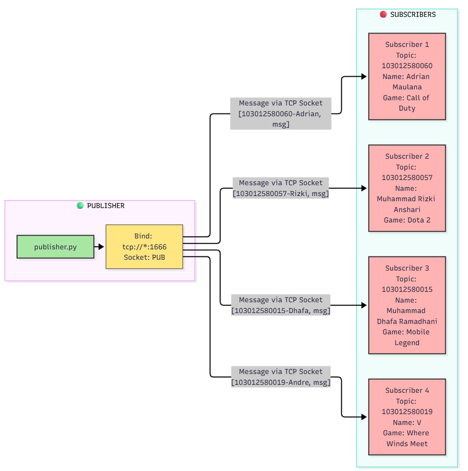
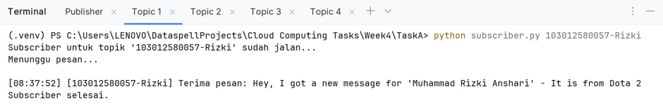
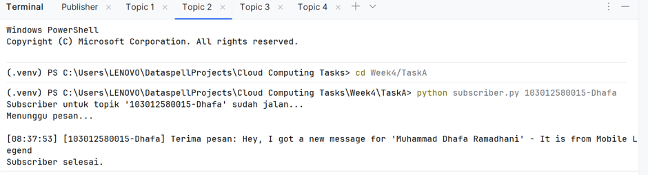
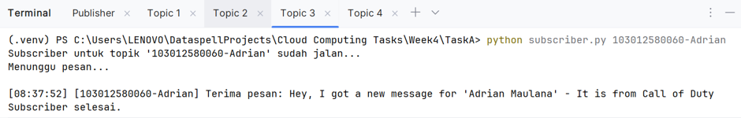
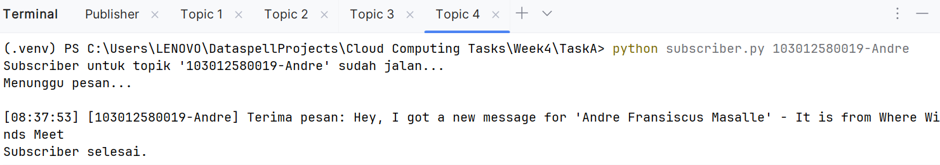

# Task A: Publish-Subscribe Pattern

## Ilustrasi

## Penjelasan Alur

Ilustrasi di atas menggambarkan komunikasi **one-to-many** antara satu **Publisher** dengan empat **Subscriber** menggunakan ZeroMQ (ZMQ) dengan pola **Publish-Subscribe (PUB/SUB)**.

**1. Inisialisasi Publisher**
- `publisher.py` membuat socket **PUB** dan **bind** ke `tcp://*:1666`.
- Publisher tidak peduli siapa yang menerima; ia hanya menyiarkan pesan ke port tersebut.

**2. Inisialisasi Subscriber**
- Setiap `subscriber.py` membuat socket **SUB** dan **connect** ke `tcp://localhost:1666`.
- Setiap Subscriber **subscribe** ke satu topik (ID masing-masing anggota).

**3. Pengiriman & Filtering Pesan**
- Publisher mengirim pesan multipart `[topik, pesan]` ke semua anggota lewat loop.
- ZMQ otomatis **memfilter** di sisi Subscriber: hanya pesan dengan topik yang cocok yang diteruskan; sisanya dibuang.

**4. Penerimaan Pesan**
- Subscriber berada di loop `while True`, menerima pesan yang lolos filter, lalu menampilkannya ke terminal dengan format `[topik] Terima pesan: ...`.

## Ringkasan Alur

| Langkah | Aktor      | Aksi                                | Port/Socket             |
|---------|------------|-------------------------------------|-------------------------|
| 1       | Publisher  | Bind socket PUB                     | `tcp://*:1666`          |
| 2       | Subscriber | Connect + Subscribe topik           | `tcp://localhost:1666`  |
| 3       | Publisher  | Kirim `[topik, pesan]` ke semua     | via TCP                 |
| 4       | ZMQ        | Filter pesan berdasarkan topik      | internal                |
| 5       | Subscriber | Terima pesan yang cocok & tampilkan | —                       |

## Screenshots

