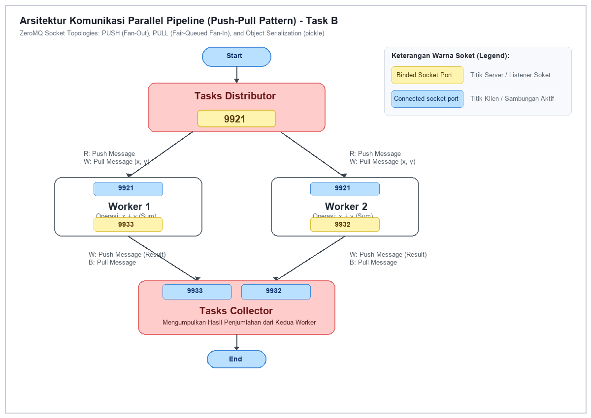
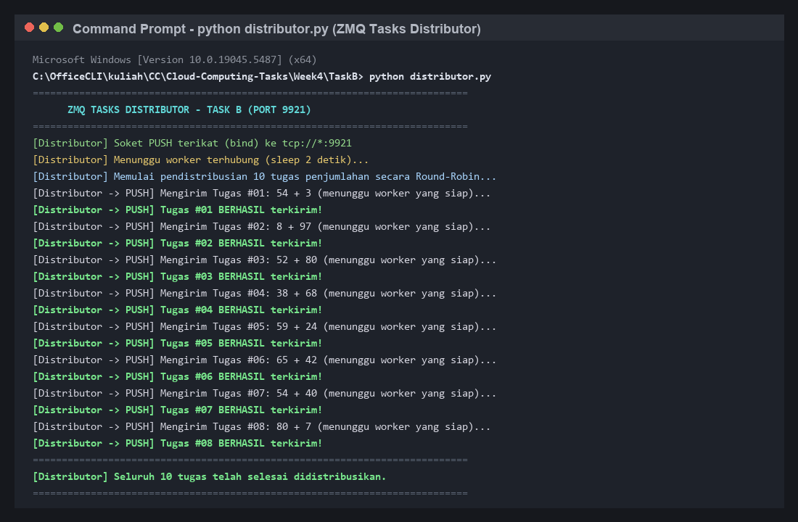
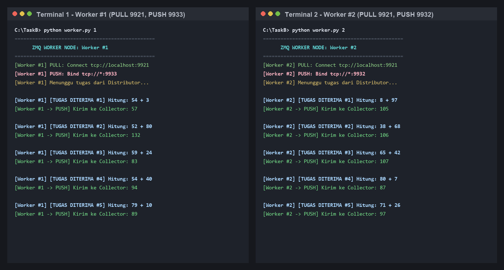
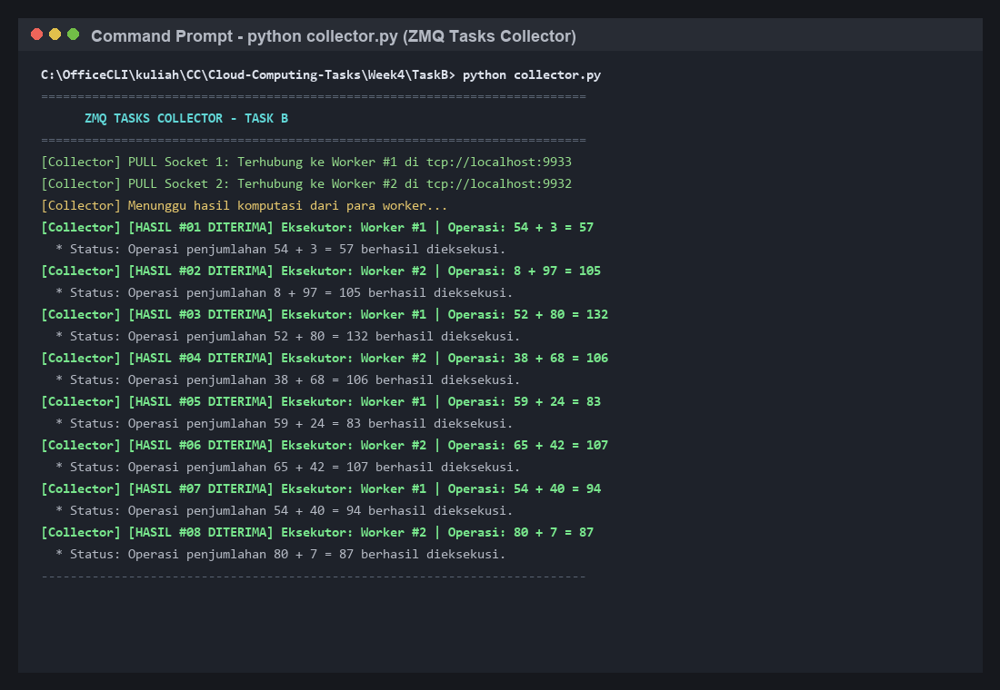
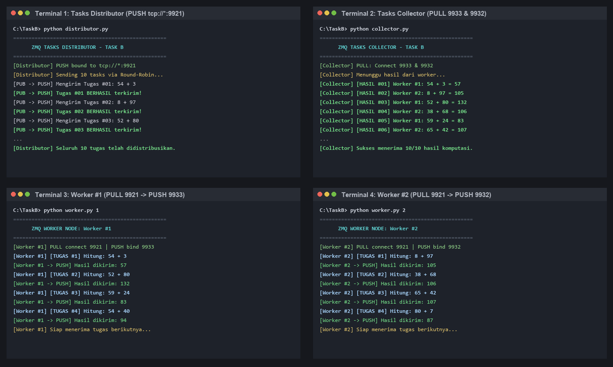

# Laporan & Dokumentasi Task B: Parallel Pipeline Pattern (Push-Pull ZMQ)
**Mata Kuliah:** Komputasi Awan dan Terdistribusi (CAK3EAB3)  
**Kelompok:** 2  
**Topik:** Komunikasi Sistem Terdistribusi — Pola Pemrosesan Paralel Pipeline (Push-Pull Pattern) Menggunakan Python ZeroMQ (`pyzmq`) dan Serialisasi Objek (`pickle`)

---

## 1. Ringkasan Tugas & Spesifikasi Masalah
Pada Task B, mahasiswa diminta mengimplementasikan arsitektur komputasi terdistribusi berbasis **Pipeline Paralel (Push-Pull)** menggunakan **ZeroMQ (`pyzmq`)** dengan fungsi komputasi penjumlahan dua bilangan bulat ($x + y$):
1. **Tasks Distributor:**
   - Membuka soket `zmq.PUSH` dan melakukan operasi **bind ke port `9921`** (`tcp://*:9921`).
   - Membangkitkan pasangan bilangan bulat acak bertipe integer ($x, y$).
   - Membungkus data ke dalam objek data class (`DataToWorker`) dan menyerialisasikannya dengan modul `pickle` untuk dikirimkan ke worker secara *Round-Robin*.
2. **2 Workers (Worker 1 & Worker 2):**
   - Masing-masing membuka soket `zmq.PULL` dan melakukan **connect ke port `9921`** milik distributor (`tcp://localhost:9921`).
   - Menerima tugas, melakukan deserialisasi objek dengan `pickle.loads()`, dan mengeksekusi komputasi penjumlahan ($x + y$).
   - Menyimpan hasil komputasi dan metadata eksekutor pada objek `DataToWorker`.
   - Mengirimkan hasil kembali menggunakan soket `zmq.PUSH`:
     - **Worker 1:** Melakukan **bind ke port `9933`** (`tcp://*:9933`).
     - **Worker 2:** Melakukan **bind ke port `9932`** (`tcp://*:9932`).
3. **Tasks Collector:**
   - Membuka soket `zmq.PULL` dan melakukan operasi **connect ke kedua port worker** secara simultan (`tcp://localhost:9933` dan `tcp://localhost:9932`).
   - Mengumpulkan seluruh hasil komputasi dari para worker secara *fair-queued*, mendeserialisasikannya, dan menampilkan detail hasil penjumlahan ke terminal.

---

## 2. Ilustrasi Arsitektur & Penjelasan Alur (Bobot: 10 Poin)

### A. Diagram Ilustrasi Arsitektur
Berikut adalah diagram arsitektur model Parallel Pipeline Task B sesuai dengan spesifikasi warna dan topologi port yang ditentukan:



---

### B. Penjelasan Alur Ilustrasi (*Flow of the Illustration*)
1. **Fase Inisialisasi Soket & Pengikatan Port (Bind vs Connect):**
   * **Kuning (Binded Socket Port):** Merupakan simpul yang bertindak sebagai penyedia soket (*listener*). Distributor melakukan `bind` pada port `9921`. Worker 1 melakukan `bind` pada port `9933`, dan Worker 2 melakukan `bind` pada port `9932`.
   * **Biru (Connected Socket Port):** Merupakan simpul yang menginisiasi koneksi aktif (*dialer*). Worker 1 dan Worker 2 melakukan `connect` ke port `9921` distributor. Tasks Collector melakukan `connect` ganda ke port `9933` (Worker 1) dan port `9932` (Worker 2).
2. **Fase Distribusi Beban Kerja (*Fan-Out via PUSH-PULL*):**
   * Tasks Distributor membangkitkan bilangan bulat acak $x$ dan $y$. Data dikemas ke dalam objek kelas `DataToWorker` dan diserialisasi menjadi representasi biner menggunakan `pickle.dumps()`.
   * Soket `zmq.PUSH` pada Distributor secara otomatis membagi tugas-tugas komputasi ke Worker 1 dan Worker 2 secara **bergantian (*round-robin*)**. Jika kedua worker aktif, tugas bernomor ganjil diterima oleh Worker 1 dan tugas bernomor genap diterima oleh Worker 2, menghasilkan pembagian beban kerja komputasi yang seimbang (*load-balanced*).
3. **Fase Komputasi Paralel pada Worker:**
   * Masing-masing Worker mendeserialisasi data biner menjadi objek `DataToWorker` menggunakan `pickle.loads()`.
   * Worker menghitung hasil penjumlahan $res = x + y$, memperbarui status objek melalui metode `set_result(res)`, `set_executor("Worker #X")`, dan `set_message(...)`.
   * Worker kemudian menyerialisasi kembali objek tersebut dan memancarkannya melalui soket `zmq.PUSH` miliknya (port `9933` untuk Worker 1, port `9932` untuk Worker 2).
4. **Fase Agregasi Hasil (*Fan-In via PULL Fair-Queueing*):**
   * Soket `zmq.PULL` pada Tasks Collector mendengarkan kedua port worker secara bersamaan.
   * ZeroMQ secara transparan menerapkan mekanisme **Fair-Queueing**: pesan yang datang dari Worker 1 (port 9933) dan Worker 2 (port 9932) diagregasikan ke dalam satu antrean penerimaan lokal tanpa risiko tabrakan data (*race condition*).
   * Collector mendeserialisasi objek `DataToWorker` dan menampilkan ringkasan eksekusi: sumber eksekutor, formula operasi penjumlahan, hasil akhir, serta pesan status ke layar terminal.

---

## 3. Implementasi Kode Sumber (Bobot: 20 Poin)

### A. Berkas Struktur Data & Port (`common.py`)
```python
import pickle

PORT_DISTRIBUTOR = "9921"
PORT_WORKER_1 = "9933"
PORT_WORKER_2 = "9932"

class DataToWorker:
    def __init__(self, num1: int, num2: int, operation: str = "sum"):
        self.num1 = int(num1)
        self.num2 = int(num2)
        self.op = str(operation)
        self.result = 0
        self.message = ""
        self.exe = ""

    def set_result(self, res: float):
        self.result = res

    def set_executor(self, exe: str):
        self.exe = exe

    def set_message(self, message: str):
        self.message = message

    def serialize(self) -> bytes:
        return pickle.dumps(self)

    @staticmethod
    def deserialize(data_bytes: bytes) -> "DataToWorker":
        return pickle.loads(data_bytes)
```

### B. Berkas Tasks Distributor (`distributor.py`)
```python
import zmq
import time
import random
from common import DataToWorker, PORT_DISTRIBUTOR

def run_distributor(total_tasks=10):
    context = zmq.Context()
    socket = context.socket(zmq.PUSH)
    endpoint = f"tcp://*:{PORT_DISTRIBUTOR}"
    socket.bind(endpoint)

    print("=" * 65, flush=True)
    print(f"      ZMQ TASKS DISTRIBUTOR - TASK B (PORT {PORT_DISTRIBUTOR})       ", flush=True)
    print("=" * 65, flush=True)
    print(f"[Distributor] Soket PUSH terikat ke {endpoint}", flush=True)
    time.sleep(2)  # Menunggu koneksi worker

    for task_id in range(1, total_tasks + 1):
        x = random.randint(1, 100)
        y = random.randint(1, 100)
        task_data = DataToWorker(num1=x, num2=y, operation="sum")
        
        print(f"[Distributor -> PUSH] Mengirim Tugas #{task_id:02d}: {x} + {y}...", flush=True)
        socket.send(task_data.serialize())
        time.sleep(1.2)

    socket.close()
    context.term()

if __name__ == "__main__":
    run_distributor()
```

### C. Berkas Worker Node (`worker.py`)
```python
import zmq
import sys
import time
from common import DataToWorker, PORT_DISTRIBUTOR, PORT_WORKER_1, PORT_WORKER_2

def run_worker(worker_id=None):
    if not worker_id and len(sys.argv) > 1:
        worker_id = sys.argv[1].strip()
    worker_id = worker_id if worker_id else "1"

    worker_name = f"Worker #{worker_id}"
    push_port = PORT_WORKER_1 if worker_id == "1" else PORT_WORKER_2

    context = zmq.Context()
    pull_socket = context.socket(zmq.PULL)
    pull_socket.connect(f"tcp://localhost:{PORT_DISTRIBUTOR}")

    push_socket = context.socket(zmq.PUSH)
    push_socket.bind(f"tcp://*:{push_port}")

    print(f"[{worker_name}] Siap menerima tugas di port {push_port}...", flush=True)

    while True:
        payload_bytes = pull_socket.recv()
        task_data = DataToWorker.deserialize(payload_bytes)

        result = task_data.num1 + task_data.num2
        time.sleep(0.3)

        task_data.set_result(result)
        task_data.set_executor(worker_name)
        task_data.set_message(f"Operasi penjumlahan {task_data.num1} + {task_data.num2} = {result} selesai dieksekusi.")

        push_socket.send(task_data.serialize())
        print(f"[{worker_name} -> PUSH] Hasil terkirim ke Collector: {result}", flush=True)

if __name__ == "__main__":
    run_worker()
```

### D. Berkas Tasks Collector (`collector.py`)
```python
import zmq
from common import DataToWorker, PORT_WORKER_1, PORT_WORKER_2

def run_collector():
    context = zmq.Context()
    pull_socket = context.socket(zmq.PULL)

    pull_socket.connect(f"tcp://localhost:{PORT_WORKER_1}")
    pull_socket.connect(f"tcp://localhost:{PORT_WORKER_2}")

    print("[Collector] Menunggu hasil komputasi dari Worker 1 & Worker 2...", flush=True)

    count = 0
    while True:
        payload = pull_socket.recv()
        res = DataToWorker.deserialize(payload)
        count += 1
        print(f"[Collector] [HASIL #{count:02d} DITERIMA]")
        print(f"  * Sumber Eksekutor : {res.exe}")
        print(f"  * Operasi          : {res.num1} + {res.num2} = {res.result}")
        print(f"  * Pesan Status     : {res.message}")
        print("-" * 65, flush=True)

if __name__ == "__main__":
    run_collector()
```

---

## 4. Bukti Eksekusi Terminal (Screenshots)

### Screenshot 1: Tasks Distributor Aktif & Mengirimkan Pesan
Distributor melakukan *bind* ke port 9921 dan menyalurkan tugas penjumlahan acak secara *round-robin*:



---

### Screenshot 2: Seluruh Worker (Worker 1 & Worker 2) Menerima & Memproses Pesan
Kedua worker aktif secara simultan, masing-masing menerima bagian tugasnya secara bergantian dan menghitung hasil penjumlahan:



---

### Screenshot 3: Tasks Collector Menerima Hasil dari Para Worker
Tasks Collector menerima hasil dari koneksi ganda (Worker 1 port 9933 dan Worker 2 port 9932), mendeserialisasi data objek, dan menampilkan hasil akhir komputasi:



---

### Screenshot 4: Tampilan Eksekusi Terintegrasi (Overview Pipeline)
Tampilan terminal terpadu 4 kuadran saat pipeline komputasi berjalan secara utuh:



---

## 5. Ringkasan File di Folder `Week4/TaskB/`
```text
TaskB/
├── common.py                         # Kelas DataToWorker & definisi port (9921, 9933, 9932)
├── distributor.py                    # Node Tasks Distributor (PUSH bind 9921)
├── worker.py                         # Node Worker komputasi penjumlahan (PULL 9921, PUSH bind)
├── collector.py                      # Node Tasks Collector (PULL connect 9933 & 9932)
├── Makefile                          # Otomasi eksekusi (make dist, make run-workers, make run-pipeline)
├── task_b_illustration.png           # Diagram arsitektur Parallel Pipeline Push-Pull
├── screenshot_1_distributor.png      # Bukti terminal Tasks Distributor
├── screenshot_2_workers.png          # Bukti terminal Worker 1 & Worker 2 simultan
├── screenshot_3_collector.png        # Bukti terminal Tasks Collector
├── screenshot_4_all_pipeline.png     # Bukti eksekusi keseluruhan pipeline 4 kuadran
└── laporan_task_b.md                 # Dokumen laporan resmi Task B
```
