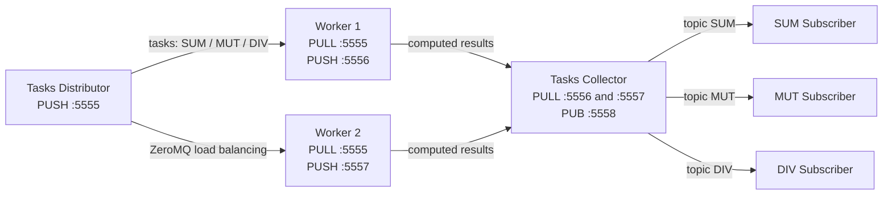

# Task C: Push-Pull and Publish-Subscribe

## Architecture illustration



## Flow explanation

1. The distributor generates two positive integers and randomly selects `sum`, `mut`, or `div`. It serializes each task and sends it through a ZeroMQ `PUSH` socket bound to port `5555`.
2. Both workers connect to that endpoint with `PULL` sockets. ZeroMQ distributes queued tasks among the available workers. Each worker performs the selected operation and sends the updated task through its own `PUSH` endpoint (`5556` or `5557`).
3. The collector connects one `PULL` socket to both worker endpoints. ZeroMQ fair-queues their results. The collector prints each result, then publishes the serialized result as a two-part message: the uppercase topic (`SUM`, `MUT`, or `DIV`) followed by the payload.
4. Each subscriber connects to the collector's `PUB` endpoint on port `5558` and subscribes to exactly one topic. Thus each result is delivered only to the subscriber for its operation.

## Run locally

Create the environment with `conda env create -f env.yml`, then activate it with `conda activate taskc-zmq`. Open six terminals in this directory and run:

```powershell
python worker_1.py
python worker_2.py
python tasks_collector_publisher.py
python sum_subscriber.py
python mut_subscriber.py
python div_subscriber.py
python tasks_distributor.py
```

The distributor sends continuously. Stop each process with `Ctrl+C`. By default, all endpoints use localhost. `DISTRIBUTOR_TOTAL_TASKS` can be set to a positive integer for a finite run; `TASK_INTERVAL_SECONDS` adjusts the delay between tasks.

## Run with Docker Compose

From the `Week4` directory, start the Task C services with `docker compose up --build taskc-distributor`. Compose starts the dependent workers, collector, and subscribers first. Follow all component output in one terminal with:

```powershell
docker compose logs -f taskc-distributor taskc-worker-1 taskc-worker-2 taskc-collector taskc-sum-subscriber taskc-mut-subscriber taskc-div-subscriber
```

Stop the services with `Ctrl+C`; remove stopped containers with `docker compose down`.

## Execution evidence

Capture screenshots of the Compose log output showing: distributor sends, both workers receive tasks, the collector receives and publishes results, and each of the three subscribers prints its matching topic and result. Keep the logs visible long enough for all three randomly selected operations to occur.
